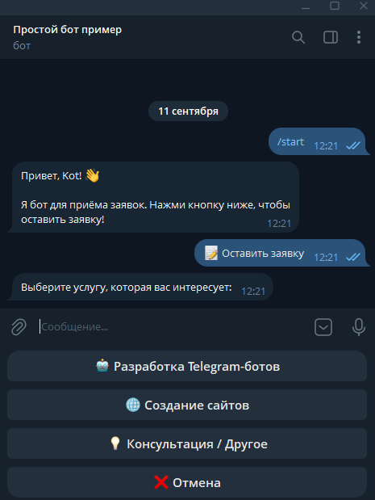
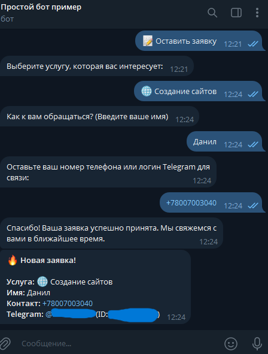
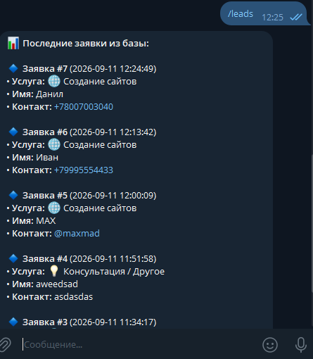
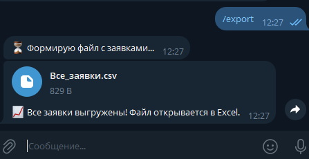
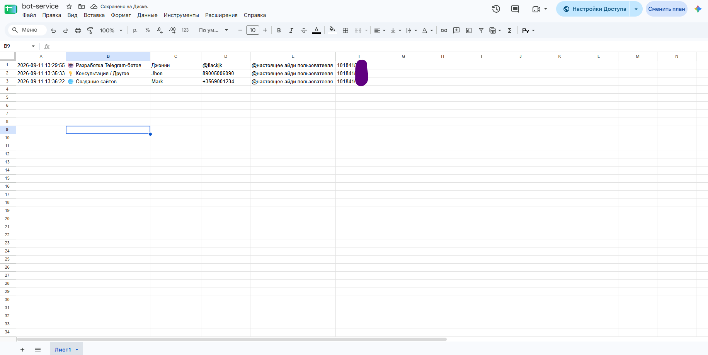

# Telegram Lead Generation Bot

[Русская версия](README.ru.md)

A Telegram bot that collects client requests (leads) through a short step-by-step form and delivers them instantly:
every lead is saved to a database, sent to the owner in a private message and appended to a Google Sheet in real time.

## Features

- **Step-by-step form (FSM):** service → name → contact, with a Cancel button on every step.
- **SQLite storage:** every lead is saved with its date and Telegram ID (async, `aiosqlite`).
- **Google Sheets sync:** new leads appear in your spreadsheet in real time (`gspread`, service account).
- **Instant admin notification:** a lead card arrives in the owner's private messages.
- **Admin commands:** `/leads` shows the last 5 leads, `/export` sends the full list as a CSV file that opens in Excel.
- **Safe by default:** the token and IDs live in `.env`, user input is HTML-escaped, non-text answers are rejected politely.

## Screenshots

| Main menu | Filling in the form |
| :---: | :---: |
|  |  |

| Admin notification | Admin panel and export |
| :---: | :---: |
|  |  |

| Google Sheet updated in real time |
| :---: |
|  |

## Tech stack

Python 3.12 · aiogram 3 · aiosqlite · gspread (Google Sheets API) · python-dotenv · Docker

## Quick start

```bash
git clone https://github.com/kot2015311/telegram-lead-bot.git
cd telegram-lead-bot
python -m venv venv
venv\Scripts\activate            # Windows
# source venv/bin/activate       # macOS / Linux
pip install -r requirements.txt
cp .env.example .env             # then fill in the values
python -m bot
```

`.env` variables:

| Variable | What it is |
| --- | --- |
| `BOT_TOKEN` | token from [@BotFather](https://t.me/BotFather) |
| `ADMIN_ID` | your numeric Telegram ID (ask [@userinfobot](https://t.me/userinfobot)) |
| `SPREADSHEET_ID` | optional; the ID from the Google Sheet URL. Leave empty to skip Sheets |

### Google Sheets (optional)

1. In Google Cloud Console create a project, enable **Google Sheets API** and **Google Drive API**.
2. Create a **service account**, add a JSON key and save it as `service_account.json` in the project root (it is git-ignored).
3. Share your spreadsheet with the service account's e-mail (Editor access).
4. Put the spreadsheet ID into `SPREADSHEET_ID`.

### Docker

```bash
docker build -t lead-bot .
docker run -d --restart unless-stopped --env-file .env \
  -v "$(pwd)/service_account.json:/app/service_account.json:ro" lead-bot
```

## Project structure

```text
bot/
├── handlers/
│   ├── admin.py         # /leads and /export, admin only
│   ├── application.py   # the lead form and notifications
│   └── start.py         # greeting and main menu
├── __main__.py          # entry point
├── config.py            # settings from .env
├── database.py          # SQLite and CSV export
├── google_sheets.py     # Google Sheets sync
├── keyboards.py         # reply keyboards
└── states.py            # FSM states
```

## Customization

The bot is a template: the list of services, the questions and the texts can be changed in `keyboards.py`
and `handlers/application.py` in minutes. Need a custom bot for your business? Contact me on Upwork.
